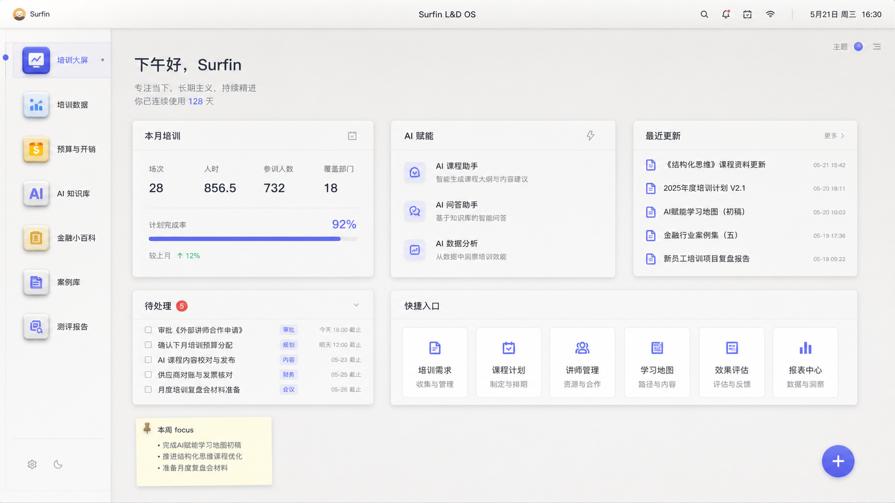
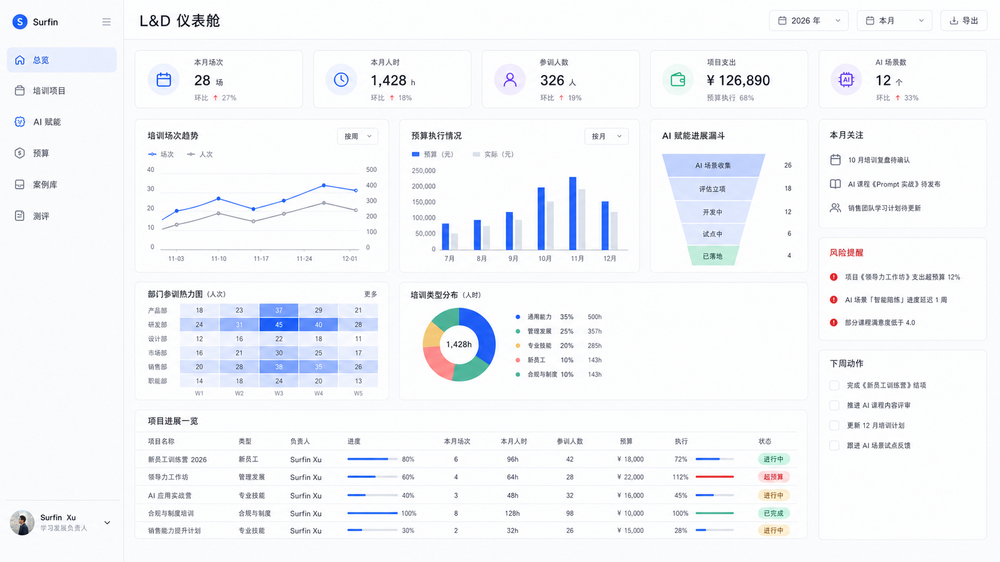

# 2026-06-03 锤子 OS 迭代方向存档

## 背景

本次围绕 Surfin L&D System 线上站点做了一轮 Product Design 快速审查，并基于“个人自用 + 锤子 OS 风格”生成了两个 16:9 视觉方向。

当前判断：

- 现有系统已经有 OS 6.x 方向：左侧系统栏、顶部工具条、主题方案、模块页面、数据卡片和数据应用都已成型。
- “管理训练营优秀案例库”是当前视觉完成度最高的模块，适合作为后续视觉质量基准。
- “培训大屏 / 仪表盘”实用、安静，但仍偏轻量后台，还可以进一步升级为更有个人 OS 气质的首页。
- 移动端顶部区域偏挤，桌面工具条按钮不适合直接压进手机顶栏。
- 登录前内部应用内容已存在于页面文本 / DOM 中，后续应先修认证层边界。

## 方向一：克制版锤子桌面

### 核心想法

这是“个人 OS 首页”的方向。重点不是炫，而是让系统像一个每天都会打开的工作桌面。

### 设计特征

- 左侧是类似 Dock 的应用栏，而不是普通后台菜单。
- 首页由多个桌面小组件组成：本月培训、AI 赋能、最近更新、待处理、快捷入口。
- 模块像一个个独立应用：培训大屏、培训数据、预算与开销、AI 知识库、金融小百科、案例库、测评报告。
- 视觉上保持锤子式克制：白灰底、细边框、轻拟物、柔和阴影、蓝紫点缀。
- 更强调“这是我的工作系统”的归属感。

### 适合承担的角色

适合作为整站主框架和首页方向。

它更符合徐老师个人自用、长期打开、低干扰、高质感的需求。

## 方向二：L&D 仪表舱

### 核心想法

这是“管理驾驶舱”的方向。重点是数据、态势、趋势和下一步动作。

### 设计特征

- 首页重点放年度 / 月度指标：场次、人时、人数、费用、AI 场景数。
- 图表更强：培训趋势、预算执行、AI 漏斗、部门热力图、项目进度表。
- 右侧有决策面板：本月关注、风险提醒、下周动作。
- 更适合月度总结、项目复盘、向上汇报前快速判断状态。
- 风格更接近专业管理看板，锤子 OS 气质会弱一些。

### 适合承担的角色

适合作为 OS 里的一个核心应用，而不是整站外层。

推荐命名为“培训大屏”或“L&D 仪表舱”，作为首页中的一个可进入模块。

## 推荐组合

主方向选择：**克制版锤子桌面**。

组合方式：

- 外层是个人 L&D OS。
- 首页是锤子风桌面。
- “L&D 仪表舱”作为其中一个核心应用。
- 案例库作为视觉质量基准。
- 高密度表格模块保持可用，但增加更明确的应用窗口边界。

这样可以同时保留两件事：

- 锤子 OS 式的个人系统感。
- L&D 数据管理和月度复盘能力。

## 下一步迭代建议

1. 先修登录边界：未登录前不要暴露内部应用内容。
2. 重做首页为“个人 L&D OS 桌面”，不要继续强化普通后台仪表盘。
3. 把原“培训大屏”升级为“L&D 仪表舱”应用。
4. 移动端顶部操作收进菜单，避免桌面工具条挤压标题区。
5. 以案例库页面为视觉基准，统一模块的标题、卡片、留白和按钮节奏。

## 本次生成图来源

- 生成工具：imagegen
- 规格：16:9 UI mockup
- 存档路径：
  - `ProjectDocs/产品设计存档/assets/2026-06-03-restrained-smartisan-desktop.png`
  - `ProjectDocs/产品设计存档/assets/2026-06-03-ld-cockpit.png`

