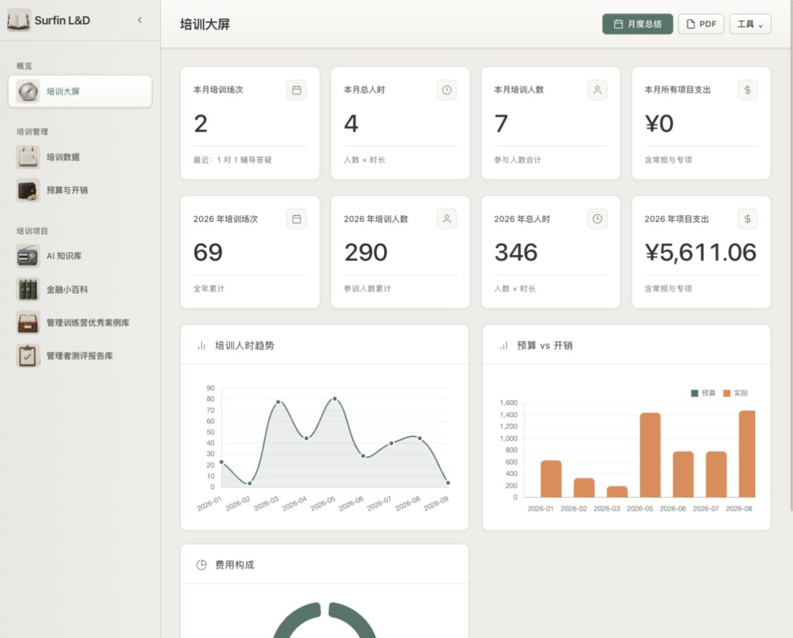

# 工作台视觉迭代与上线验收

- 完成日期：2026-09-11
- 状态：界面迭代完成，GitHub Pages 已发布并验收。
- 线上入口：https://coriaxu.github.io/surfin-ld-system/
- 发布分支：`main`，站点目录为仓库根目录。
- 发布提交：`ad23911d580d1d81cf515fb9d75ae75e957a7342`
- 提交说明：`Refine learning workspace visuals and editing controls`

## 用户确认与本轮范围

徐老师确认按“锤子系统应用”的方向迭代材质、图标、按钮、文字、布局和配色，随后明确授权发布到 GitHub 线上。

培训大屏保持既有定位：其他模块更新后自动汇总展示。大屏不增加记录入口；具体记录仍在各业务模块维护。

## 已交付

- 暖灰工作区、白色内容面板、清楚的边框、轻微高光和阴影。默认主题为“暖灰工作台”，首页八张 KPI 卡片统一白色；其余主题入口保留。
- 七个主模块使用精绘实物图标，品牌入口使用书本图标。案例库保留国家标识，其他案例图标及预算标签去除混杂 Emoji。
- 提高字段字号、文字对比度和标题层级，统一按钮尺寸、主次关系、按下反馈与键盘焦点。
- 顶部保留月度总结、PDF，将主题、Excel、JSON、云同步、备份码和导入收进工具菜单。
- 培训、预算、开销采用编辑抽屉；金融期次编辑移至页面容器之外，改为侧边抽屉。AI 广播站和分享月沿用原有录入位置及工作流。
- 培训、预算、开销、AI 记录及金融编辑中的删除按钮收进“更多”，保留原有确认与处理逻辑。
- 统一案例与测评资料页的标题、面板和目录风格，保留模块结构与资料内容。
- 修复窄屏导航展开、顶部工具隐藏和表格挤压；移动端表格支持横向滚动。

## 实现文件

- `index.html`：接入样式与交互资源、调整窄屏导航分支，并包含本地已有的文字对比度修正。
- `assets/workbench.css`：统一主题、组件、抽屉与响应式样式。
- `assets/workbench.js`：工具菜单、更多菜单、图标、抽屉、字段标签关联和键盘交互。
- `assets/module-icons.png`：精绘主模块图标资源。

## 验收证据

- 全部应用脚本通过语法检查。
- 已检查七个模块的显示与主要入口，以及培训、预算、开销和金融期次编辑界面的打开与关闭。
- 在独立测试副本新增“3 人 × 2 小时”的培训记录后，大屏自动显示 1 场、3 人、6 人时；再编辑为 4 人，列表显示 8 人时。保存后抽屉正常关闭。
- 手机宽度下检查导航展开、模块切换、工具菜单和主题选择；表格以横向滚动维持可读性。
- 本轮界面实现前后，正式 `data.json` 与 `user-data.json` 内容一致。发布前发现远端只有 `user-data.json` 更新，已快进到远端最新版本 `22c7071d302637b934140e323744bf29ee0ccf3e`，保留最新业务数据后提交界面。
- 发布提交只包含以上四份实现文件，未包含项目笔记和业务数据。
- GitHub Pages 构建结果为 `built`，对应发布提交，错误信息为空。
- 线上 `index.html`、CSS、JavaScript、图标资源均返回 HTTP 200，内容散列与本地发布版本一致。
- 线上浏览器确认白色 KPI 面板、工具菜单、三个记录抽屉及七个主导航图标已加载。

## 范围与后续边界

- 本轮完成主主题与既有模块的界面迭代，不涉及业务流程重构、认证机制改造或登录权限调整。
- 其余四个主题保留，但未进行逐页完整验收。
- 6 月的“OS 首页 / 仪表舱”概念图作为历史探索保留，不代表已实施或自动列入后续任务。
- 没有新增待发布项。本存档与项目状态记录保存在项目本地云盘目录。

## 界面预览

以下为本轮最终本地验收截图；线上版本另经资源一致性与浏览器验收确认。

