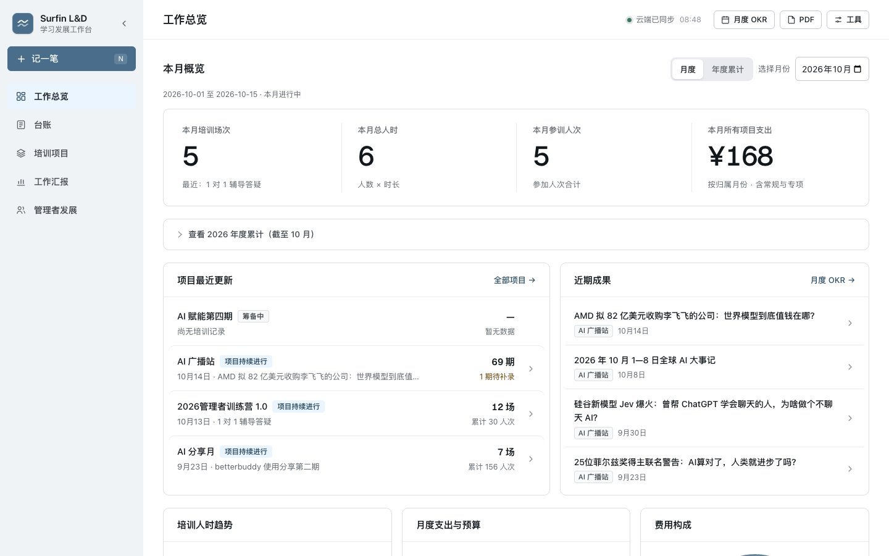
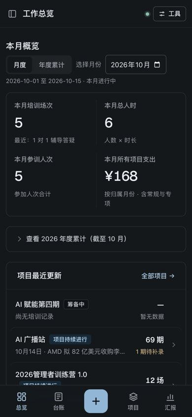

# 「明账」改版上线验收

- 完成日期：2026-10-15
- 状态：已发布 GitHub Pages 并验收
- 线上入口：https://coriaxu.github.io/surfin-ld-system/
- 发布提交：`2dcadca`（实现）；本存档与项目笔记另行提交
- 设计稿：Claude Design 画布「学习发展系统 · 设计升级方案」
- 设计系统：Claude Design System「学习发展 · 明账」（8 套主题、9 个组件、品牌手册、标识），仅徐老师可见，分享需在页面 Share 菜单操作

## 徐老师确认的范围

- 2026-10-14：侧栏分组「培训记录」改名「台账」；旧五套主题收为浅色＋深色。
- 2026-10-14：四个主色全要（晴山蓝默认、鼠尾草、山梗紫、淡咖啡）；深色截图里的三色做浅色版，作为状态色；要深色模式；建 Claude Design System；直接开发。
- 2026-10-15：总览「待补齐」区域不需要，删除（连同侧栏、底栏数量角标）。
- 2026-10-15：授权提交、合并、发布上线。

## 已交付

- 令牌：`tools/tokens.py` 为唯一来源，生成 `assets/tokens.css`，四个主色 × 浅深两套全部通过对比度校验（正文 ≥4.5:1，实测 `ink-3` ≥5.3:1；主按钮文字 ≥5.3:1；无标签图形 ≥3:1），不达标即报错不出文件；`--json` 同时输出设计系统用的 tokens.json。
- 外观：`assets/appearance.js` 在 `<head>` 中先设 `data-mode`／`data-accent`，避免闪烁；工具菜单内切换外观（浅色／深色／跟随系统）与主色，偏好存本浏览器 `ld_mode`、`ld_accent`；旧 `surfin_theme` 偏好自动清除。
- 状态三色固定：浪花绿＝已结项，沙石黄＝待补／待回收，榴子红＝待核对；标签圆角 4，不做胶囊形。
- 导航：分组「台账」，首页「培训场次」，首页标题「工作总览」；侧栏「记一笔」（快捷键 N），五种类型复用原有抽屉；手机端底部五栏，中间为记一笔，弹出底部弹层。
- 总览：本月四个数改为账面条；培训场次表格底部常驻筛选合计（与总览、月报同一口径，缺数只计条数）。
- 汇报页：月度 OKR、年度总结、结项报告正文 15–16px、标题放大，OKR 状态标签换为状态色。
- 数字字体 Geist 由 jsDelivr 加载 `@fontsource/geist-sans@5.2.5`，加载失败回落系统字体。

## 验收证据

- `node --test tests/*.test.*`：36 项全过（改版前后一致）。
- 本地 Playwright（口令登录、本地 user-data.json）：桌面 11 个页面深色、多页浅色，手机 6 屏，四个主色各至少一屏；无控制台错误、无横向滚动。开发中曾因删除旧主题选择器多留一个 `
` 导致内容区错位，已修复并复测。
- GitHub Pages 构建 `built`，对应 `2dcadca`；线上 `index.html` 与 7 个改动资源 HTTP 200，SHA-256 与本地一致。
- 线上未登录层检查：浅色主色 `#496D8B`、深色主色 `#92B6D5` 生效，记一笔、手机底栏、外观选项与新导航名称均已加载，无脚本错误。线上登录后的页面未由 AI 代为输入口令验证，依据为线上文件与本地验证版本逐字节一致。

## 已知未做

- 管理者测评报告库的团队报告卡仍沿用旧的左侧色条。
- `index.html` 中旧主题选择器的残留样式（`.theme-switcher` 一段）未清理，不生效。
- 设计稿画布仍画有已删除的「待补齐」区块，属方案稿，未同步。

## 界面预览

